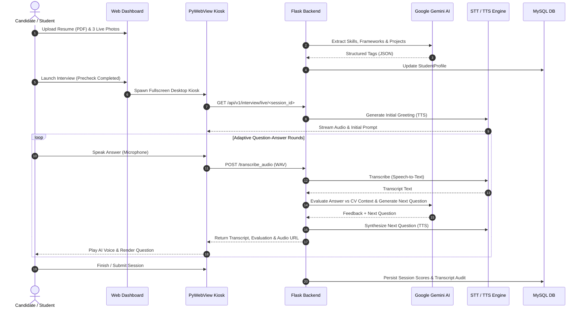
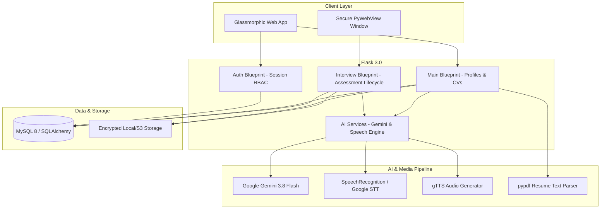

<div align="center">

# 🎯 SkillScreen AI

### *Autonomous AI-Powered Campus Placement & Technical Mock Interview Platform*

[](https://hacktoberfest.com/)
[](https://www.python.org/)
[](https://flask.palletsprojects.com/)
[](https://ai.google.dev/)
[](https://pywebview.flowrl.com/)
[](https://www.mysql.com/)
[](LICENSE)

<br/>

**Elevate campus recruitment with real-time conversational AI interviews, dynamic follow-up questioning, automated resume skill extraction, and secure proctoring.**

[Explore Features](#-key-features) • [System Architecture](#-system-architecture) • [Getting Started](#-getting-started) • [API Reference](#-api-endpoints) • [Proctoring & Integrity](#-proctoring--integrity) • [Roadmap](#-interactive-roadmap)

---

</div>

## 📌 Executive Summary

**SkillScreen AI** is a full-stack assessment and mock-interview ecosystem designed for colleges, students, and corporate recruiters. It bridges the gap between campus recruitment scale and interview quality:

- 🎓 **Students** practice adaptive, voice-enabled technical interviews contextualized against their own resumes.
- 🏢 **Recruiters** configure customized placement drives and interview templates to automate initial technical screening rounds.
- 🏫 **Placement Cells** track cohort readiness, audit candidate integrity, and maintain fair, transparent evaluation records.
- ⚖️ **Human-in-the-Loop Philosophy**: The AI evaluates and recommends, but human recruiters retain final decision-making power.

---

## ✨ Key Features

### 🧠 Adaptive Conversational AI Engine
* Powered by **Google Gemini 3.8 Flash** (`gemini-3.8-flash`).
* Dynamic question generation tailored specifically to the candidate's resume, projects, and live conversational answers.
* Generates contextual follow-ups rather than rigid question banks.

### 🎙 Real-Time Voice Synthesis & Speech Recognition
* **Speech-to-Text (STT)**: Transcribes candidate spoken answers seamlessly.
* **Text-to-Speech (TTS)**: Synthesizes high-fidelity voice prompts via Google Speech Synthesis (`gTTS`), enabling a fluid, lifelike conversational interview.

### 📄 Intelligent Resume Extraction & Skill Tagging
* High-speed, in-memory PDF resume extraction using `pypdf`.
* Automatic JSON-based classification extracting:
  * Key technical skills
  * Projects & domain experiences
  * Frameworks, libraries, and tools
  * Subjects of interest

### 🛡 Kiosk-Style Secure Lockdown Browser
* Standalone desktop lockdown launcher (`secure_browser.py`) built on `pywebview`.
* Fullscreen execution with disabled address bars, restricted multi-tasking, disabled text selection, and window close confirmation guards.

### 📸 Tri-Angle Biometric & Hardware Precheck
* Candidate identity verification using 3 distinct live reference webcam snapshots.
* Step-by-step diagnostic precheck confirming camera feed, microphone input, and screen-sharing permissions before launching assessment sessions.

### 🎨 Modern Glassmorphic Dark-Mode UI
* Responsive, high-contrast user interface styled with subtle gradients, frosted-glass components, glowing highlights, and real-time timers.

---

## 🏛 System Architecture

### 🔄 End-to-End Interview Workflow



---

## 🏗 High-Level Component Topology



---

## 📂 Repository Directory Tree

```text
Hacktoberfest 26/
├── app/
│   ├── __init__.py               # Flask application factory (create_app)
│   ├── config.py                 # Centralized configuration & environment loader
│   ├── extensions.py             # SQLAlchemy and Flask-Migrate instances
│   ├── models/                   # Relational domain models
│   │   ├── __init__.py           # Model exports
│   │   ├── user.py               # User identity & roles (Student, Recruiter, Admin)
│   │   ├── profile.py            # StudentProfile, CV text, extracted skills JSON
│   │   ├── company.py            # Company verification & recruiter relationships
│   │   ├── drive.py              # PlacementDrive and Candidate Invitations
│   │   └── interview.py          # Templates, Questions, Sessions & Rubrics
│   ├── routes/                   # HTTP Controller Blueprints
│   │   ├── auth.py               # Registration, Login, and Session management
│   │   ├── main.py               # Dashboard routing, CV parsing & live photo capture
│   │   └── interview.py          # Hardware precheck, live shell, STT, and scoring
│   ├── static/
│   │   └── css/
│   │       └── style.css         # Modern dark glassmorphic styling
│   ├── templates/                # Jinja2 presentation templates
│   │   ├── index.html            # Landing page with interactive hero
│   │   ├── login.html            # Authentication view
│   │   ├── register.html         # Role-based account registration
│   │   ├── student_dashboard.html# Student practice hub & score summary
│   │   ├── recruiter_dashboard.html# Placement drive & candidate candidate portal
│   │   ├── profile.html          # Profile builder, CV previewer, 3-angle webcam capture
│   │   ├── precheck.html         # Camera/Mic/Screen diagnostic test
│   │   ├── interview_launched.html # Kiosk browser notification
│   │   └── interview_shell.html  # Live split-screen AI interview interface
│   ├── uploads/                  # Temporary and persistent media store (CVs, photos, audio)
│   └── utils/
│       ├── __init__.py
│       └── ai_services.py        # Gemini Flash, Speech-to-Text, and TTS integrations
├── migrations/                   # Alembic database versioning scripts
├── .env.example                  # Environment configuration template
├── .gitignore                    # Git tracking exemptions
├── requirements.txt              # Production and development dependencies
├── run.py                        # Application entry point
├── secure_browser.py             # PyWebView standalone proctoring lockdown window
└── README.md                     # Project documentation
```

---

## 🚀 Getting Started

Follow these steps to set up and run **SkillScreen AI** locally.

### 1. Prerequisites
Ensure you have the following installed:
* **Python 3.10+** ([Download Python](https://www.python.org/downloads/))
* **MySQL Server** (or XAMPP / MariaDB) running on port `3306`
* **Google Gemini API Key** ([Get your free Gemini API Key](https://aistudio.google.com/))

### 2. Clone the Repository
```bash
git clone https://github.com/your-username/skillscreen-ai.git
cd skillscreen-ai
```

### 3. Create & Activate a Virtual Environment
```bash
# On Linux / macOS:
python3 -m venv venv
source venv/bin/activate

# On Windows (PowerShell):
python -m venv venv
.\venv\Scripts\Activate.ps1
```

### 4. Install Dependencies
```bash
pip install --upgrade pip
pip install -r requirements.txt
```

> [!TIP]
> On Linux systems, make sure you have the required audio and webview libraries installed:
> ```bash
> sudo apt-get install portaudio19-dev python3-pyaudio libwebkit2gtk-4.0-37
> ```

### 5. Configure Environment Variables
Copy the template file `.env.example` to create your local `.env`:
```bash
cp .env.example .env
```

Open `.env` and configure your credentials:

```ini
# Flask Security Key
SECRET_KEY=use_your_own_secret_key

# Database Connection (MySQL / MariaDB)
DATABASE_URL=mysql+pymysql://root:@localhost:3306/skillscreen_db

# Google Gemini API Key
# Replace the placeholder below with your key from Google AI Studio:
GEMINI_API_KEY=use_your_own_api_key
```

> [!IMPORTANT]
> **API Key Notice**: Never commit your real API keys or secrets to version control. Keep them secured inside your local `.env` file (which is already configured in `.gitignore`).

### 6. Set Up the Database
Create the database in MySQL:
```sql
CREATE DATABASE skillscreen_db CHARACTER SET utf8mb4 COLLATE utf8mb4_unicode_ci;
```

Run database migrations to initialize all tables:
```bash
flask db upgrade
```
*(Or if running for the first time without pre-existing migrations, run `flask db init && flask db migrate && flask db upgrade`)*

### 7. Run the Application
Launch the Flask development server:
```bash
python run.py
```

The application will start at:
👉 **`http://127.0.0.1:5000`**

---

## 🔌 API Endpoints

<details>
<summary><b>Click to expand the Complete API Route Reference</b></summary>
<br/>

### Authentication (`/api/v1/auth`)
| Method | Endpoint | Description | Access |
| :--- | :--- | :--- | :--- |
| `GET` / `POST` | `/api/v1/auth/login` | Authenticate user session with email & password | Public |
| `GET` / `POST` | `/api/v1/auth/register` | Create a new user profile (`student`, `recruiter`) | Public |
| `GET` | `/api/v1/auth/logout` | Terminate session and redirect to landing page | Authenticated |

### Core & Profile (`/`)
| Method | Endpoint | Description | Access |
| :--- | :--- | :--- | :--- |
| `GET` | `/` | SkillScreen AI landing page and feature showcase | Public |
| `GET` | `/health` | Application status & service health check | Public |
| `GET` | `/dashboard` | Role-based dashboard redirect (`student` vs `recruiter`) | Authenticated |
| `GET` | `/profile` | Candidate profile view with resume previewer | Student |
| `POST` | `/upload_cv` | Upload PDF resume, extract text, and auto-tag skills | Student |
| `POST` | `/update_profile` | Update manual skill tags and project descriptions | Student |
| `POST` | `/upload_live_photos` | Capture and store 3-angle webcam identity photos | Student |
| `GET` | `/view_cv/<filename>` | Stream resume PDF within the browser | Student / Recruiter |

### AI Interview Engine (`/api/v1/interview`)
| Method | Endpoint | Description | Access |
| :--- | :--- | :--- | :--- |
| `GET` | `/api/v1/interview/precheck/<session_id>` | Hardware diagnostic interface (Cam / Mic / Screen) | Student |
| `POST` | `/api/v1/interview/start/<session_id>` | Launch lockdown desktop window via `secure_browser.py` | Student |
| `GET` | `/api/v1/interview/live/<session_id>` | Live split-pane interview shell (video feed, chat, audio) | Student |
| `POST` | `/api/v1/interview/verify_identity/<session_id>` | Verify presence of reference biometric photos | Student |
| `POST` | `/api/v1/interview/transcribe_audio/<session_id>`| Upload candidate audio clip & transcribe to text | Student |
| `POST` | `/api/v1/interview/submit_answer/<session_id>` | Evaluate answer with Gemini AI & synthesize next question | Student |
| `GET` | `/api/v1/interview/audio/<filename>` | Stream synthesized question audio (`.mp3`) | Student |
| `GET` | `/api/v1/interview/end/<session_id>` | Conclude interview and safely close kiosk session | Student |

</details>

---

## 🔒 Proctoring & Integrity

SkillScreen AI employs a multi-tiered approach to ensure evaluation validity and fairness:

```text
┌────────────────────────────────────────────────────────┐
│               Integrity Verification Stack             │
├────────────────────────────────────────────────────────┤
│ 1. Hardware Diagnostic (Camera / Mic / Permissions)    │
│ 2. Tri-Angle Webcam Baseline (Stored at Onboarding)    │
│ 3. pywebview Desktop Lock-down (Fullscreen, No URL Bar)│
│ 4. Client-side Visibility & Focus Change Listeners     │
│ 5. AI Reasoning Validation against Candidate Resume    │
│ 6. Recruiter Audit Dashboard with Full Audio Logs      │
└────────────────────────────────────────────────────────┘
```

> [!NOTE]
> **Candidate Privacy**: Biometric snapshots and audio recordings are stored strictly for recruiter audit verification and are managed under college data-retention guidelines.

---

## 👥 Roles & User Journeys

<details>
<summary><b>Click to expand Role Permissions & Workflows</b></summary>
<br/>

```
  ┌─────────────────────────────────────────────────────────────────┐
  │                           ROLE MATRIX                           │
  ├──────────────────┬───────────┬───────────┬──────────────────────┤
  │ Capability       │  Student  │ Recruiter │ Placement Admin      │
  ├──────────────────┼───────────┼───────────┼──────────────────────┤
  │ Resume Upload    │     ✅    │     ❌    │          ❌          │
  │ Mock Practice    │     ✅    │     ❌    │          ❌          │
  │ Create Drives    │     ❌    │     ✅    │          ❌          │
  │ Approve Drives   │     ❌    │     ❌    │          ✅          │
  │ Review Answers   │     ❌    │     ✅    │          ✅          │
  │ Final Decisions  │     ❌    │     ✅    │          ❌          │
  │ System Audit Log │     ❌    │     ❌    │          ✅          │
  └──────────────────┴───────────┴───────────┴──────────────────────┘
```

1. **Student Journey**: Register ➡️ Upload Resume ➡️ Complete 3-Angle Face Capture ➡️ Review Extracted Skill Tags ➡️ Run Hardware Diagnostic Precheck ➡️ Launch Secure AI Interview ➡️ Review Scores & Recommendations.
2. **Recruiter Journey**: Register Company ➡️ Create Placement Drive ➡️ Configure Rubric Weights (Coding, Problem Solving, Technical, Communication) ➡️ Invite Candidates ➡️ Review AI Transcripts & Human Verification Decision.
3. **Placement Cell Journey**: Verify Student Profiles ➡️ Authorize Company Drives ➡️ Monitor Placement Drive Participation & Analytics.

</details>

---

## 🗺 Interactive Roadmap

- [x] **Core Web Platform**: Flask factory architecture with SQLAlchemy ORM & Alembic migrations.
- [x] **Gemini 3.8 Flash Integration**: Resume parsing, skill extraction, adaptive question & follow-up generation.
- [x] **Voice Pipeline**: Real-time Speech-to-Text (STT) and dynamic audio synthesis (TTS).
- [x] **Lockdown Browser**: Kiosk-style `pywebview` client preventing tab-switching during interviews.
- [x] **Biometric Identity Precheck**: 3-angle webcam capture and hardware diagnostic checks.
- [ ] **Sandboxed Code Execution Engine**: Secure containerized runtime for live algorithmic challenges.
- [ ] **Multi-Speaker Diarization**: Advanced proctoring detecting multiple voices or background murmurs.
- [ ] **College Placement ERP Sync**: Webhook integration with campus management portals.
- [ ] **Granular Analytics Export**: PDF / CSV export of candidate evaluation scorecards for placement cells.

---

## 🤝 Contributing

Contributions make the open-source community an inspiring place to learn, inspire, and create! Any contributions you make are **greatly appreciated**.

1. Fork the Project.
2. Create your Feature Branch (`git checkout -b feature/AmazingFeature`).
3. Commit your Changes (`git commit -m 'feat: Add some AmazingFeature'`).
4. Push to the Branch (`git push origin feature/AmazingFeature`).
5. Open a Pull Request.

### 🏷 Hacktoberfest 2026 Guidelines
* Check open issues labeled `hacktoberfest`, `good first issue`, or `enhancement`.
* Quality contributions only—spam or low-effort PRs will be flagged and closed.
* Adhere to PEP-8 Python style standards and write modular, tested code.

---

## 📄 License

Distributed under the **MIT License**. See `LICENSE` for more information.

---

<div align="center">

**Built with ❤️ for Campus Placements and Hacktoberfest 2026**

<sub>Give this repository a ⭐ if you found it helpful!</sub>

</div>
